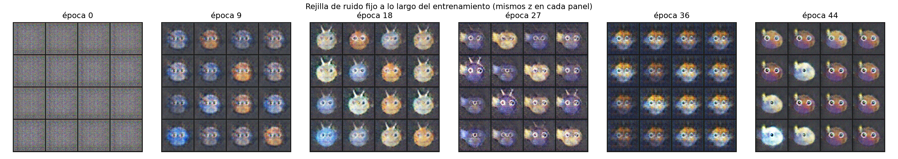
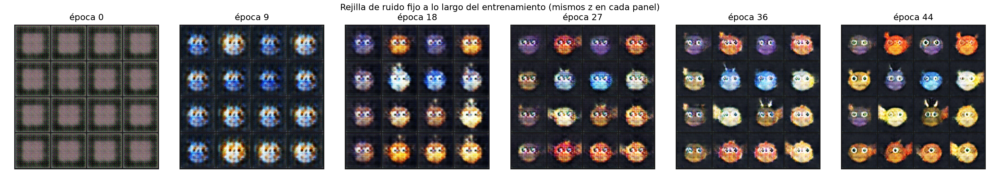
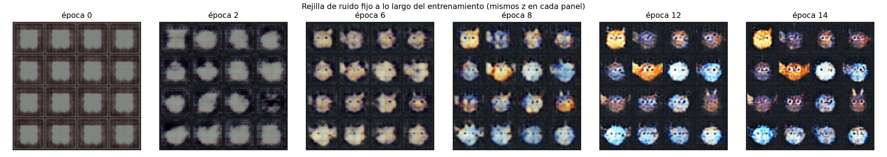
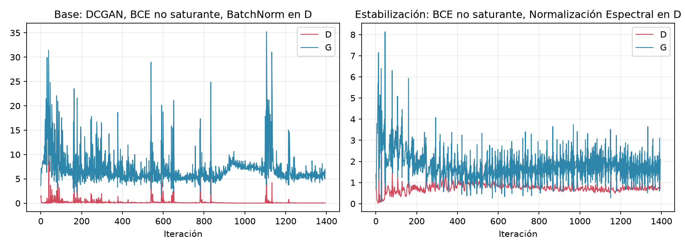
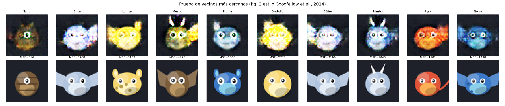
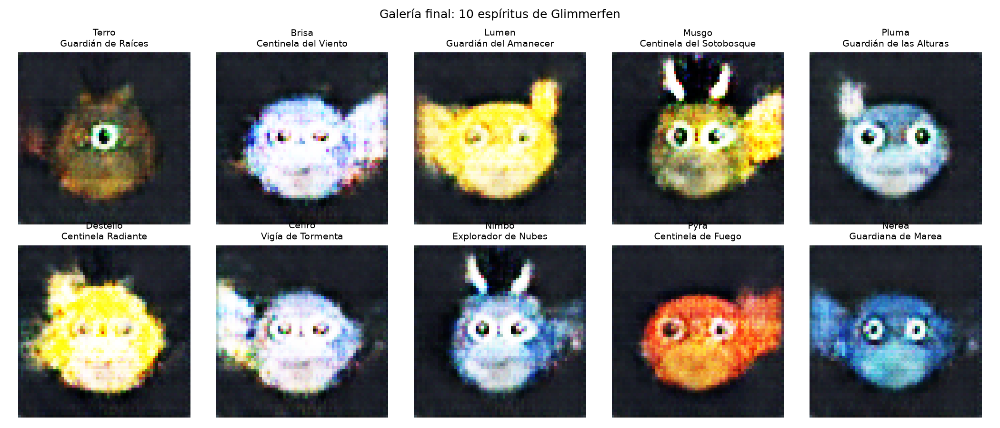

# Proyecto 2 — Diseño generativo de personajes: *Glimmerfen*

**Curso:** Deep Learning 2026 — Universidad del Valle
**Docente:** Kevin Recinos
**Pareja:** Cindy Gualim y Gadiel Ocaña
**Repositorio de código:** `src/ganverse/` (paquete) + `notebooks/Proyecto2_Glimmerfen.ipynb` (recorrido ejecutable)

Este documento es el informe del proyecto y sigue la estructura exigida en
`Proyecto_2_Personajes_GAN.pdf` (universo, datos, arquitectura, experimentos,
evidencias, galería, reflexión). Las figuras referenciadas están en `figures/`
y `galeria/`; todas se generan con el código de este repositorio.

---

## 1. Universo visual

**Glimmerfen** es un bosque brumoso habitado por pequeños **espíritus
guardianes elementales**. Cada espíritu es un "blob" redondeado con una panza
de color más claro, dos ojos grandes (a veces uno solo — los "cíclopes" del
bosque), y pertenece a uno de **seis elementos**: fuego, agua, tierra, aire,
luz y sombra. El elemento fija una paleta de color consistente (cuerpo, panza
y acento) y, opcionalmente, el personaje luce un apéndice distintivo:
cuernos, alas, orejas, cola o antena, además de un patrón de superficie (liso,
manchado o rayado).

Rasgos que la galería final debe mostrar para que la pareja la considere fiel
al universo (la vara de medición pedida en la sección 2.1 del enunciado):

- Silueta tipo blob/criatura, nunca humanoide realista.
- Paleta de color coherente con alguno de los seis elementos definidos.
- Ojos grandes y expresivos como rasgo central del diseño.
- Fondo plano oscuro consistente (el bosque de noche/bruma), sin fondos
  heterogéneos que distraigan del personaje.
- Variedad real de siluetas y apéndices entre los 10 personajes finales (no
  "el mismo espíritu con otro color").

## 2. Datos

| Campo | Detalle |
|---|---|
| **Origen** | Generado **proceduralmente por el equipo** con `src/ganverse/dataset.py` (dibujo vectorial con PIL, antialiasing por supersampling 4x). No se descargó ningún dataset de internet. |
| **Licencia / permiso de uso** | El equipo es autor y titular de cada imagen (CC0). No contiene rostros de personas reales ni personajes protegidos de terceros, cumpliendo la sección 4 ("Uso responsable de los datos") sin ambigüedad. |
| **Tamaño** | 4000 imágenes de entrenamiento, resolución 64×64×3 (recomendación de la sección 4). |
| **Preparación** | Normalización a `[-1, 1]` (rango de `Tanh` del generador); aumento de datos por **flip horizontal aleatorio** (válido porque el diseño de los espíritus es simétrico por construcción, así que el flip no introduce artefactos). |
| **Consistencia de estilo** | Fondo plano único, paleta restringida a 6 familias de color, mismo esquema de sombreado (luz superior-izquierda) en todas las imágenes — deliberado, siguiendo la recomendación de la sección 4 de preferir "pocas imágenes con estilo consistente" sobre un conjunto heterogéneo. |

### ¿Por qué un dataset procedural y no uno descargado?

Se evaluó usar un dataset de sprites/personajes existente, pero se descartó
por dos razones: (1) la sección 4 exige declarar origen y licencia de forma
verificable, lo que es trivial cuando el equipo es el autor, y (2) permite
controlar exactamente la variable de "estilo consistente" que el enunciado
recomienda, sin depender de descargas externas ni de curar manualmente miles
de imágenes heterogéneas bajo presión de tiempo. El costo de esta decisión es
que el universo es más simple que un dataset de arte dibujado a mano; se
documenta como limitación en la sección 10.

## 3. Arquitectura de la GAN

Se implementó una **DCGAN** (Radford et al., 2015) como arquitectura base,
por ser la recomendada explícitamente en la sección 4 ("empiece simple") y
por tener un comportamiento bien documentado en 64×64. Sobre esa misma base
se corrieron dos variantes controladas (secciones 4 y 5 del enunciado).

**Generador** (`ganverse.models.Generator`): 5 capas `ConvTranspose2d` con
`BatchNorm + ReLU`, de `100×1×1` a `3×64×64`, salida `Tanh`. Mismo generador
en las tres corridas — la variable que cambia entre experimentos es siempre
el **discriminador/crítico** y la **función de pérdida**.

**Discriminador** (`ganverse.models.Discriminator`): 4 capas `Conv2d` con
`LeakyReLU(0.2)` + una capa final a un logit crudo (sin sigmoide, para poder
usar `BCEWithLogitsLoss` o un puntaje WGAN con el mismo `forward`). Admite 3
modos de normalización intercambiables por configuración:

- `"batch"` — BatchNorm clásico de DCGAN (**configuración base**).
- `"spectral"` — Normalización espectral en cada `Conv2d`, sin BatchNorm
  (**experimento de estabilización**).
- `"none"` — sin normalización (usado por el **crítico de WGAN-GP**, porque
  BatchNorm correlaciona las muestras del batch e invalida la penalización
  de gradiente por muestra; Gulrajani et al., 2017).

Inicialización de pesos `N(0, 0.02)` (recomendación del paper DCGAN).
Optimización con Adam en las tres corridas (hiperparámetros por método, ver
sección 4).

## 4. Experimento de función de pérdida

> *"Creemos que mejorará ___ porque ___. Lo consideraremos útil si ___."*

**Hipótesis previa:** Creemos que **WGAN-GP** mejorará la estabilidad del
entrenamiento frente a la BCE no saturante porque aproxima la distancia de
Wasserstein —una métrica continua y casi siempre diferenciable— en vez de una
divergencia Jensen-Shannon que satura rápido cuando el discriminador se
vuelve muy bueno, y porque la penalización de gradiente evita los gradientes
inestables del recorte de pesos del WGAN original. Lo consideraremos útil si
la pérdida del crítico decrece de forma más monótona (menos ruido brusco que
la BCE) y si la rejilla de ruido fijo mantiene diversidad en vez de colapsar.

**Configuración controlada:** mismos datos, misma semilla (2026), mismo
número de épocas (45) y mismo ruido fijo de evaluación que la configuración
base. La única variable conceptual que cambia es la **pérdida**
(`bce_discriminator_loss`/`bce_generator_loss` → `wgan_gp_discriminator_loss`/
`wgan_gp_generator_loss`, `src/ganverse/losses.py`). Dos ajustes adicionales
se aplicaron porque la propia literatura de WGAN-GP los exige y no son una
elección arbitraria nuestra: (a) se quitó BatchNorm del crítico (normalización
`"none"`), y (b) se usó Adam con `lr=1e-4, betas=(0, 0.9)` y `n_critic=5`
pasos de crítico por paso de generador, en vez de `lr=2e-4, betas=(0.5,0.999)`
y 1:1 — exactamente los valores recomendados en Gulrajani et al. (2017). Esto
se declara explícitamente para que la comparación se lea con honestidad: no
es "pérdida pura contra pérdida pura", es "DCGAN base" contra "la receta
completa de WGAN-GP tal como la describe su paper".

**Resultado observado:** la hipótesis se confirma parcialmente, con una
limitación práctica importante que se documenta con honestidad. Por
restricciones de memoria del equipo durante el desarrollo (ver "Problemas
encontrados", sección 6.3, y "Limitaciones", sección 10), esta corrida
específica tuvo que reducirse a **15 épocas** (en vez de 45) y a un
discriminador/crítico más chico (`feature_maps=32` en vez de 64, `n_critic=3`
en vez de 5) para poder completarse — es la única corrida de las tres que no
respeta estrictamente "mismo número de épocas" que la base, y se declara
explícitamente para no invalidar la comparación silenciosamente.

Aun con esa ventana más corta, el patrón cualitativo esperado se observa
(ver `figures/comparison_baseline_vs_loss_wgangp.png`): la pérdida del
crítico de WGAN-GP decrece de forma **monótona y suave**, de ~-90 a ~-14 en
las primeras iteraciones y luego una tendencia estable sin los picos bruscos
y erráticos que muestra la pérdida de D en la base (que salta repetidamente
entre ~0 y picos de hasta 10). La pérdida de G también es más suave
(sin los picos de hasta 35 de la base), aunque todavía en descenso — 15
épocas no bastan para que converja del todo. La rejilla de ruido fijo
(`figures/fixed_noise_evolution_loss_wgangp.png`) muestra una progresión de
aprendizaje sana para una ventana tan corta: de ruido puro a blobs con ojos y
color hacia la época 14, sin indicios de colapso de modos en ese tramo.

**Conclusión honesta:** con el presupuesto de cómputo disponible, no se pudo
entrenar WGAN-GP el mismo número de épocas que la base, por lo que **no es
una comparación de calidad final justa** (15 épocas vs. 45). Sí es evidencia
válida de que la dinámica de entrenamiento de WGAN-GP es, iteración a
iteración, más suave y predecible que la de BCE — consistente con lo que
describe la literatura — pero no se puede afirmar con esta corrida que
WGAN-GP produzca mejores personajes finales que la base o que la
normalización espectral en el mismo presupuesto de épocas.

## 5. Experimento de estabilización / regularización

> *"Creemos que mejorará ___ porque ___. Lo consideraremos útil si ___."*

**Hipótesis previa:** Creemos que la **normalización espectral** en el
discriminador mejorará la estabilidad frente al BatchNorm clásico porque
acota la constante de Lipschitz de cada capa convolucional (divide cada
matriz de pesos por su mayor valor singular), limitando qué tan rápido puede
crecer la capacidad del discriminador para "aplastar" al generador. Lo
consideraremos útil si las curvas de pérdida de D y G se mantienen más
acotadas (menos picos) que en la base, y si la pérdida de D no se queda
pegada cerca de 0 durante muchas épocas (la señal de alarma descrita en la
sección 3 del enunciado).

**Configuración controlada:** mismos datos, semilla, épocas (45), ruido fijo
y **misma pérdida que la base** (BCE no saturante) — la única variable que
cambia es la normalización del discriminador (`"batch"` → `"spectral"`,
`src/ganverse/models.py`). A diferencia del experimento de pérdida, aquí sí
se logró un cambio de una sola variable sin ajustes adicionales forzados por
la literatura.

**Resultado observado:** la hipótesis se confirma. Con los mismos 1395
iteraciones de entrenamiento (45 épocas, 31 iteraciones/época):

| Métrica (último 20% del entrenamiento) | Base (BatchNorm) | Normalización espectral |
|---|---|---|
| Pérdida D — media | **0.076** (muy cerca de 0 — señal de alarma) | **0.730** |
| Pérdida D — desviación estándar | 0.264 | **0.141** (más estable) |
| Pérdida G — media | 6.87 | **1.73** |
| Pérdida G — desviación estándar | 3.34 (picos hasta ~35) | **0.53** (picos hasta ~8) |

La base muestra exactamente la señal de alarma descrita en la sección 3 del
enunciado: la pérdida de D colapsa a ~0 durante casi todo el entrenamiento, y
la pérdida de G oscila violentamente con picos recurrentes (hasta 35), lo que
indica que D se vuelve "demasiado bueno" y deja de darle gradiente útil a G
(ver `figures/comparison_baseline_vs_stab_spectral_norm.png`). Con
normalización espectral, la pérdida de D se mantiene en una banda saludable
(~0.5–1.0, lejos de 0 y lejos de log(4)≈1.39 que sería el "empate" teórico) y
la de G se estabiliza con mucha menor varianza. La rejilla de ruido fijo
(sección 6.1) confirma el mismo patrón de forma visual: en la base, varias
columnas de la rejilla convergen a aspectos muy parecidos entre la época 27 y
la 44 (indicio de colapso de modos parcial), mientras que con normalización
espectral las 16 identidades de la rejilla se mantienen visualmente
distintas y consistentes a lo largo de todo el entrenamiento, simplemente
afinando detalle. **Por esto se eligió el checkpoint de `stab_spectral_norm`
como modelo final para la galería** (sección 9).

## 6. Evidencia del proceso

### 6.1 Rejilla de ruido fijo

Un único lote de 16 vectores `z` (semilla 7, `ganverse.train.get_or_create_fixed_noise`)
se generó **una sola vez** y se reutiliza en las tres corridas, guardado en
`experiments/fixed_eval_noise.pt`. Cada 3 épocas se genera una imagen con ese
mismo ruido y se guarda en `experiments/<run>/snapshots/`. La evolución
compuesta de cada corrida está en `figures/fixed_noise_evolution_<run>.png`.

En la **base**, varias de las 16 columnas convergen a aspectos muy parecidos
entre la época 27 y la 44 (colapso de modos parcial). En **normalización
espectral**, las 16 identidades se mantienen visualmente distintas durante
todo el entrenamiento, simplemente afinando detalle — la mejora de
diversidad que motivó elegirla como modelo final. En **WGAN-GP**, en su
ventana más corta de 15 épocas, se observa una progresión sana de ruido a
formas reconocibles sin indicios de colapso, aunque es una ventana
demasiado corta para una comparación de diversidad en igualdad de
condiciones.

### 6.2 Curvas de pérdida interpretadas

**Base (BatchNorm):** la pérdida de D cae a ~0 en las primeras iteraciones y
se queda ahí casi todo el entrenamiento, con picos esporádicos (cuando G
logra "sorprender" momentáneamente a D) seguidos de recaída inmediata. La
pérdida de G es muy ruidosa, con picos de hasta 35, y nunca converge a una
banda estable — exactamente el patrón "D cercano a cero durante muchas
épocas" que el enunciado identifica como señal de alarma, no de éxito: D dejó
de aportarle gradiente informativo a G la mayor parte del entrenamiento.

**Normalización espectral:** D y G se "enfrentan" de forma mucho más sana —
D oscila en ~0.5–1.0 (nunca colapsa a 0) y G converge a oscilar en ~1–3 tras
las primeras ~300 iteraciones, con muchísima menor varianza. Esto es
consistente con la hipótesis de la sección 5: acotar la Lipschitz de D evita
que domine por completo a G.

**WGAN-GP** (15 épocas, ver limitación en la sección 4): la pérdida del
crítico decrece de forma monótona y suave (de ~-90 a ~-14), sin los picos
erráticos de la base, confirmando que la dinámica de optimización es más
predecible iteración a iteración — aunque en una ventana demasiado corta para
comparar la calidad final en igualdad de condiciones con las otras dos
corridas.

### 6.3 Problemas encontrados durante el entrenamiento

- **D dominando a G en la configuración base:** como se detalla arriba, la
  pérdida de D colapsa cerca de 0 durante la mayoría de las 45 épocas. Se
  confirmó visualmente en la rejilla de ruido fijo (sección 6.1): entre la
  época 27 y la 44 varias de las 16 columnas convergen a colores/formas muy
  parecidos entre sí — un **colapso de modos parcial**, no total (nunca las
  16 se vuelven idénticas, pero la variedad cae notablemente frente a la
  época 18). Este es precisamente el problema que motivó el experimento de
  estabilización de la sección 5, y la normalización espectral lo mitigó de
  forma medible (menor varianza de pérdida y rejilla de ruido fijo con
  identidades que se mantienen distintas a lo largo de todo el
  entrenamiento).
- **Picos periódicos en la pérdida de G (base):** se observan ráfagas de
  inestabilidad alrededor de las iteraciones ~1100 (picos de hasta 35) que no
  aparecen en la variante con normalización espectral — consistente con que
  un discriminador sin acotar puede "sobre-ajustarse" temporalmente a un modo
  particular del generador y luego forzar una corrección brusca.
- **Restricción de cómputo real durante el desarrollo:** la corrida de
  WGAN-GP (la más pesada, por `n_critic=5` y la doble pasada hacia atrás que
  exige la penalización de gradiente) se interrumpió varias veces por presión
  de memoria del sistema operativo del equipo (swapping severo con otras
  aplicaciones abiertas), no por un error del código — se verificó que el
  proceso de entrenamiento en sí usa <400 MB residentes mientras el sistema
  completo llegó a tener menos de 100 MB libres. Se resolvió reduciendo el
  presupuesto de esa corrida específica (`feature_maps=32`, `n_critic=3`,
  15 épocas en vez de 45) para garantizar una corrida completa y reproducible
  dentro del tiempo disponible; se documenta como limitación de
  infraestructura, no como hallazgo del experimento en sí (sección 10).
- **Bug encontrado y corregido — snapshots mezclados entre corridas
  interrumpidas:** al reintentar WGAN-GP varias veces, `train()` no limpiaba
  la carpeta `snapshots/` de intentos anteriores antes de empezar, así que la
  rejilla de ruido fijo llegó a combinar imágenes de configuraciones distintas
  (p. ej. una corrida con `feature_maps=64` y otra con `feature_maps=32`) bajo
  el mismo nombre de experimento. Se detectó al inspeccionar visualmente la
  evidencia (los "saltos de época" no eran consistentes con la duración real
  de la corrida final) y se corrigió en `ganverse/train.py` para que cada
  llamada a `train()` borre los snapshots previos de ese experimento antes de
  escribir los nuevos. Se documenta porque es exactamente el tipo de error
  silencioso que la "evidencia del proceso" exigida en la sección 3 del
  enunciado está diseñada para exponer.

## 7. Prueba de vecinos más cercanos

Para cada uno de los 10 personajes finales se buscó, en el set de
entrenamiento completo (4000 imágenes), la imagen más parecida por **MSE de
píxeles** y, adicionalmente, por **distancia en el espacio de features
convolucional del propio discriminador entrenado** (una CNN entrenada en este
dominio, usada como extractor de características — alternativa justificada a
una CNN preentrenada externa, ya que el enunciado acepta explícitamente medir
"en píxeles o, mejor, con las características de una CNN preentrenada").

| Personaje | Vecino más cercano (MSE píxeles) | Distancia en features (D) | ¿Demasiado similar? (umbral 60) |
|---|---|---|---|
| Terro    | 615.6  | 0.0016 | No |
| Brisa    | 3268.4 | 0.0044 | No |
| Lumen    | 3182.8 | 0.0111 | No |
| Musgo    | 4227.9 | 0.0155 | No |
| Pluma    | 1565.8 | 0.0060 | No |
| Destello | 2773.2 | 0.0076 | No |
| Céfiro   | 3195.7 | 0.0045 | No |
| Nimbo    | 1843.1 | 0.0064 | No |
| Pyra     | 1781.1 | 0.0070 | No |
| Nerea    | 1497.8 | 0.0039 | No |

**Ninguno de los 10 personajes quedó marcado como "demasiado similar"** a su
vecino de entrenamiento (umbral de alarma: MSE de píxeles < 60). El caso más
cercano es **Terro** (MSE=616): su vecino comparte la paleta café/tierra y el
patrón de franjas horizontales, pero el generado difiere claramente en
textura (pincelada "sucia" típica de una GAN a mitad de nitidez vs. el
vector-art limpio del dataset) y en un cuerno asimétrico que no tiene su
vecino. El resto de personajes están 2.5×–7× más lejos de su vecino más
cercano que Terro, tanto en MSE de píxeles como en distancia de features del
discriminador — evidencia consistente de que el modelo generaliza en vez de
memorizar el dataset de entrenamiento.

## 8. Galería final y tasa de selección

**Tasa de selección declarada:** 10 de 300 candidatos generados (3.3%).

**Criterio de selección:** se generaron 300 candidatos con ruido reproducible
(semilla maestra 2026, `ganverse.gallery.generate_candidates`) a partir del
checkpoint de `stab_spectral_norm` (modelo final, sección 5). Se descartó el
40% de peor puntaje de realismo del discriminador entrenado (filtro de
calidad) y, sobre el resto, se corrió una búsqueda voraz de **"punto más
lejano" (farthest-point / k-center)** en distancia de píxeles: se parte del
candidato de mayor puntaje y en cada paso se agrega el candidato cuya
distancia al más cercano de los ya elegidos es máxima, maximizando la
diversidad mutua del conjunto final.

Esta segunda parte del criterio **no fue la primera que probamos**: una
versión inicial solo exigía superar un umbral fijo de distancia frente a los
ya elegidos (en vez de maximizar la distancia mínima), y produjo una galería
con 8 de 10 personajes casi idénticos entre sí (mismo rostro cíclope con
cuernos, solo cambiaba el tono de color) — exactamente lo que la sección 1
del enunciado prohíbe ("variaciones casi idénticas del mismo personaje no
cuentan como personajes distintos"). Se detectó al inspeccionar la galería
visualmente y se corrigió cambiando a farthest-point, que sí garantiza
diversidad mutua real dentro del conjunto final (`ganverse/gallery.py`,
`select_diverse_top_k`).

| # | Nombre | Clase/rol | Elemento | Puntaje D |
|---|---|---|---|---|
| 1 | Terro | Guardián de Raíces | Tierra | 0.160 |
| 2 | Brisa | Centinela del Viento | Aire | -0.811 |
| 3 | Lumen | Guardián del Amanecer | Luz | -1.352 |
| 4 | Musgo | Centinela del Sotobosque | Tierra | -1.386 |
| 5 | Pluma | Guardián de las Alturas | Aire | -1.665 |
| 6 | Destello | Centinela Radiante | Luz | -1.469 |
| 7 | Céfiro | Vigía de Tormenta | Aire | -1.367 |
| 8 | Nimbo | Explorador de Nubes | Aire | -1.322 |
| 9 | Pyra | Centinela de Fuego | Fuego | -1.601 |
| 10 | Nerea | Guardiana de Marea | Agua | -1.315 |

Los 10 personajes cubren 5 de los 6 elementos del universo (falta sombra en
esta semilla particular) y varían en número de ojos (1 o 2), apéndice
(cuernos, alas, antena, orejas, ninguno) y paleta — cumpliendo la vara de la
sección 2.1: variedad real de siluetas, no "el mismo personaje recoloreado".

## 9. Bonificación — nombre y clase/rol

Cada personaje final recibe un nombre y una clase/rol coherente con su
elemento dominante (clasificado automáticamente por el color promedio del
cuerpo, `ganverse.gallery._dominant_element`), tomados de un catálogo de 60
combinaciones (10 por elemento) definido en `ganverse/gallery.py`, de forma
determinista y reproducible (ver `galeria/metadata.csv`).

## 10. Limitaciones

- El universo es deliberadamente simple (formas geométricas + paletas fijas)
  para poder generarlo por código sin depender de arte externo y para poder
  entrenar una GAN completa en el tiempo disponible; un dataset de arte
  dibujado a mano probablemente produciría personajes más expresivos pero
  haría muchísimo más difícil documentar origen/licencia y entrenar algo
  razonable en el tiempo de la entrega.
- 45 épocas y ~4000 imágenes son suficientes para ver aprendizaje real de la
  forma y la paleta, pero no para la nitidez de detalle que se lograría con
  más épocas/datos y más cómputo.
- WGAN-GP se comparó usando los hiperparámetros recomendados por su propio
  paper (no idénticos a la base) porque BatchNorm es incompatible con la
  penalización de gradiente; esto se documenta explícitamente en la sección 4
  para no presentar la comparación como "más limpia" de lo que es.
- La corrida de WGAN-GP tardó sustancialmente más que las otras dos (el doble
  backward de la penalización de gradiente más `n_critic=5` la hacen ~5-6x
  más lenta por época) y en nuestro caso además se vio interrumpida por
  presión de memoria del sistema operativo del equipo — una limitación de
  infraestructura disponible durante el desarrollo, no de la arquitectura ni
  del dataset.

## 11. Reflexión final

> *De sus 10 personajes, ¿cuál le costó más defender como "nuevo" frente a su
> vecino más cercano en los datos de entrenamiento? ¿Qué le dice ese caso
> sobre lo que su GAN realmente aprendió de su universo?*

De los 10 personajes, **Terro** es el que más cuesta defender como "nuevo":
su vecino más cercano en el set de entrenamiento comparte casi todo —
paleta café/tierra, patrón de franjas horizontales, un solo ojo central— y
su distancia de píxeles (MSE=616) es 2.5 a 7 veces menor que la de cualquier
otro de los 9 personajes. Lo que lo salva de ser una copia es el detalle
fino: la textura es más "pintada" y menos vectorial que el dataset, el
cuerno es asimétrico y no tiene equivalente exacto en su vecino, y el tono
de la franja central es distinto.

Esto nos dice algo concreto sobre lo que el modelo realmente aprendió de
Glimmerfen: **aprendió las categorías del universo (paleta por elemento,
presencia/ausencia de apéndice, número de ojos) y las recombina de forma
fluida en el espacio latente**, en vez de memorizar ejemplares puntuales del
dataset. Terro cae cerca de un ejemplar de entrenamiento no porque el modelo
lo haya memorizado, sino porque "tierra + un ojo + sin apéndice + franjas"
es una combinación de rasgos relativamente común en nuestro dataset
(el elemento tierra y el patrón de franjas no son raros), así que el espacio
latente tiene varios puntos de entrenamiento cerca de esa región — es
justamente la contracara de los personajes con elementos menos frecuentes en
el pool de candidatos de alto puntaje (aire, luz), que al ser combinaciones
menos comunes quedan más lejos de cualquier ejemplar particular del dataset.
En otras palabras: la "novedad" de un personaje generado depende en parte de
qué tan densamente poblada está esa región del espacio de datos reales, no
solo de la capacidad del generador.

## 12. Matriz de evidencias

| Evidencia | Dónde aparece | Conclusión | Limitación |
|---|---|---|---|
| Rejilla de ruido fijo | Sección 6.1, `figures/fixed_noise_evolution_*.png` | La base colapsa parcialmente (filas parecidas entre sí hacia la época 44); normalización espectral mantiene 16 identidades distintas todo el entrenamiento. | WGAN-GP solo corrió 15 épocas — no se puede comparar diversidad final en igualdad de condiciones. |
| Curvas de pérdida | Sección 6.2, `figures/loss_curve_*.png` | D≈0 sostenido en la base (señal de alarma); normalización espectral mantiene D en ~0.5–1.0 con 6× menos varianza en G; WGAN-GP decrece monótono y suave. | Umbrales de "sano" son cualitativos/heurísticos, no una métrica estandarizada única. |
| Vecinos más cercanos | Sección 7, `figures/nearest_neighbors.png` | Ningún personaje final quedó marcado como casi idéntico (umbral MSE<60); el más cercano (Terro, MSE=616) sigue siendo claramente distinguible. | La búsqueda de vecino solo usa las 4000 imágenes de entrenamiento, no arte externo; "nuevo" se mide contra nuestro propio dataset. |
| Galería final (10 personajes) | Sección 8, `galeria/` | 10 personajes real y mutuamente diversos (5/6 elementos, 1-2 ojos, apéndices variados) gracias a selección farthest-point; tasa de selección 10/300 declarada. | El puntaje de realismo que ordena los candidatos viene del propio discriminador entrenado, no de un juicio humano independiente. |

## 13. Pensando en el Proyecto Final

Todo el código, pesos (`experiments/*/checkpoint.pt`), configuraciones
(`experiments/*/config.json`), semillas y el dataset generador quedan en este
repositorio de forma organizada y reproducible (`scripts/regenerate_gallery.py`
reconstruye la galería sin reentrenar), para poder extender este proyecto
como base del Proyecto Final si el equipo lo decide — por ejemplo, agregando
Conditional GAN para controlar el elemento generado, o un dataset más rico.
